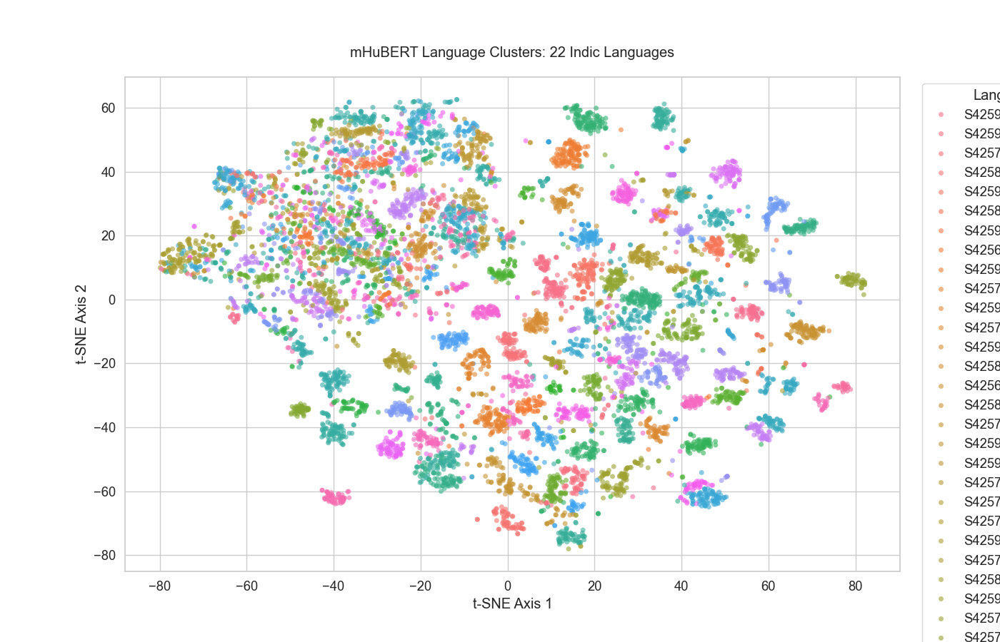
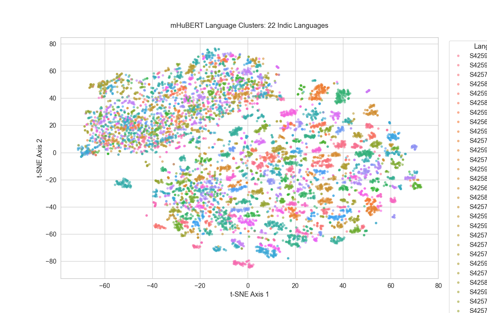
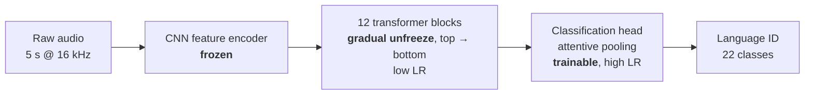
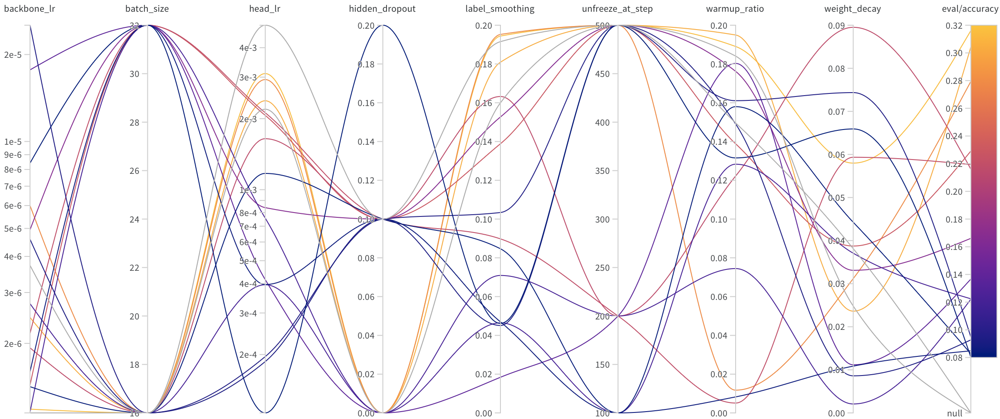

# Spoken Language Identification for 22 Indian Languages

Fine-tuning a multilingual speech transformer (**mHuBERT-147**) to identify which of 22 languages of the Indian
subcontinent is spoken in a short audio clip — and investigating **why the model learns speakers instead of languages**,
and how to fix it.

> Course project for *Neural Networks: Theory and Implementation* (Saarland University, Prof. Dr. Dietrich Klakow).
> 📄 **[Read the report (PDF)](report/main.pdf)**

## Highlights

The course provided a reference baseline (MMS-300m, 3 epochs on an L4 GPU) at **31.96%** top-1 accuracy;
chance level for 22 classes is 4.54%. Our final model reaches **52.4%**, about **+20 points** over the reference.

| Stage | Top-1 accuracy |
|---|---|
| Chance level (22 classes) | 4.5% |
| Our first reproduction of the baseline setup (MMS-300m / mHuBERT-147) | 18.0% / 16.7% |
| Reference baseline provided by the course (MMS-300m) | 31.96% |
| mHuBERT-147 + Bayesian hyperparameter optimization & gradual unfreezing | 46.7% |
| + Speed / pitch / noise augmentation | 50.0% |
| + Speed / noise + **k-NN voice conversion** | **52.4%** |

- **Speaker bias diagnosis.** With only 5 speakers per language, the model can shortcut by recognizing *voices*.
  A leave-one-speaker-out split exposed this, and t-SNE plots of the final-layer embeddings made it visible.
- **k-NN voice conversion (kNN-VC)** re-synthesizes each utterance in other speakers' voices, so speaker identity no longer
  predicts the language label. Speaker clusters largely disappear after training on this data:

| Before bias correction | After kNN-VC |
|---|---|
|  |  |

- **A remaining confounder.** Further t-SNE analysis on metadata showed a split by *recording scenario*
  (conversation vs. extempore) that kNN-VC cannot remove — languages with similar scenario distributions cluster together
  regardless of language family. Hyperparameter tuning can't compensate for structural dataset bias.

## Method



- **Backbone:** [`utter-project/mHuBERT-147`](https://huggingface.co/utter-project/mHuBERT-147), chosen over
  `facebook/mms-300m` for comparable accuracy at a fraction of the compute.
- **Training:** AdamW + cosine schedule with warmup, discriminative learning rates (head vs. backbone),
  label smoothing, and top-down **gradual layer unfreezing** of the transformer blocks (CNN feature encoder stays frozen).
- **Hyperparameter search:** Bayesian optimization with Weights & Biases sweeps (17 runs). Head LR and label smoothing
  were the most important parameters:

  

- **Bias correction:** torchaudio augmentations (speed, pitch, noise) and kNN-VC voice conversion.
- **Analysis:** leave-one-speaker-out evaluation, confusion matrices grouped by language family, t-SNE of embeddings
  colored by speaker, language, age and recording scenario.

## Compute

| Workload | Hardware |
|---|---|
| Baselines and hyperparameter sweeps | Google Colab, NVIDIA **T4** |
| Speaker-bias experiments (augmented training, GPU pitch shifting) | Google Colab, NVIDIA **L4** |
| Building the augmented / kNN-VC datasets | MacBook Pro, Apple **M1 Pro** |

The repo also contains a Docker image and job scripts for running training on an HTCondor GPU cluster.

## Repository layout

```
code/
  train_model.py        # final model: best hyperparameters + speed/noise/kNN-VC augmentation
  scripts/              # preprocessing (plain, augmentation, kNN-VC), LOO-speaker eval, t-SNE, HF Hub upload
  notebooks/            # experiment notebooks (baselines, sweeps, augmentation, analysis)
  Dockerfile, deploy.sh, sync_job.sh   # containerized training on an HTCondor GPU cluster
plots/                  # t-SNE visualizations
report/                 # LaTeX source and PDF of the report
```

Setup and step-by-step reproduction instructions are in [`code/readme.md`](code/readme.md).

**Dataset:** [`badrex/nnti-dataset-full`](https://huggingface.co/datasets/badrex/nnti-dataset-full) on Hugging Face.

## Tech stack

PyTorch · Hugging Face Transformers & Datasets · torchaudio · Weights & Biases · scikit-learn · Docker · HTCondor

## Authors

- Dmitrii Tsybulkin
- Nicholas Pham
- Regina Nitsch
